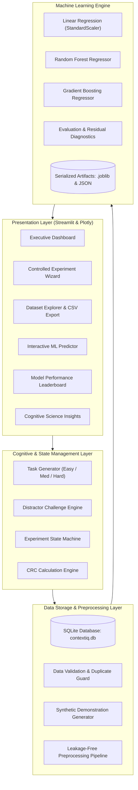
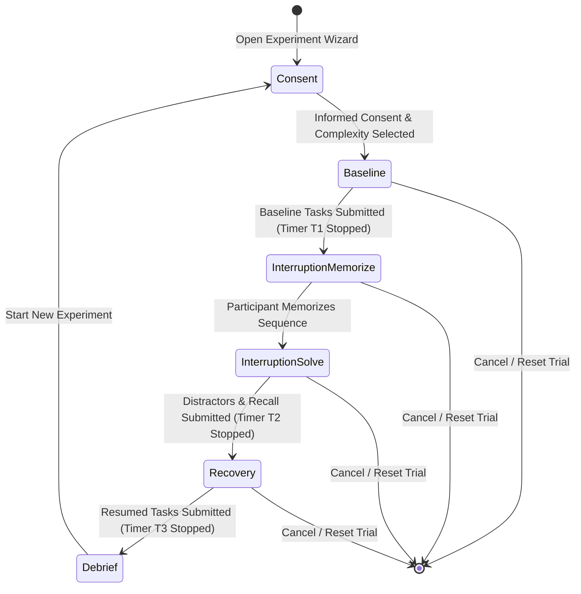

# RECLAIM — System Architecture & Technical Specifications

This document details the software architecture, state machine dynamics, data flows, and machine learning pipelines powering **RECLAIM** (Productivity Intelligence), an analytics platform quantifying human context recovery latency after digital interruptions.

---

## 1. High-Level System Architecture

RECLAIM is built as a modular, decoupled full-stack machine learning application:



---

## 2. Controlled Experiment State Machine

To ensure reliable timing across asynchronous participant page re-renders, ContextIQ implements an explicit finite state machine (FSM) in `experiments/experiment.py`:



### State Machine Guarantees:
1. **Zero Rehearsal Overlap**: The task generator partitions pools into disjoint sets. Questions presented in the Baseline condition never reappear in the Recovery condition.
2. **Surprise Distraction**: Memory stimulus tokens and distractor tasks are never revealed until the participant completes and submits the baseline task.
3. **Graceful Cancellation**: At any step prior to database commit, the participant can cancel or restart the session without corrupting database integrity.

---

## 3. Mathematical Operational Definitions

### Primary Metric: Context Recovery Cost (CRC) Excess-Time Proxy
Cognitive recovery latency is operationally defined as the incremental execution latency required to complete an equivalent task post-interruption relative to baseline speed:

$$\text{CRC}_{\text{excess}} = \max\left(0, T_{\text{recovery}} - T_{\text{baseline}}\right)$$

Where:
- $T_{\text{baseline}}$ is uninterrupted task completion duration in seconds.
- $T_{\text{recovery}}$ is post-interruption task completion duration in seconds for an equivalent question set.

### Relative Latency Overhead Ratio ($R_{\text{CRC}}$)
$$R_{\text{CRC}} = \frac{T_{\text{recovery}}}{\max(0.1, T_{\text{baseline}})}$$

### Accuracy Retention Differential ($\Delta \text{Acc}$)
$$\Delta \text{Acc} = \text{Accuracy}_{\text{recovery}} - \text{Accuracy}_{\text{baseline}}$$

### Switch Density ($S_{\text{density}}$)
$$S_{\text{density}} = \frac{\text{Switch Count}}{\left(\frac{T_{\text{baseline}} + T_{\text{interruption}} + T_{\text{recovery}}}{60}\right)}$$

---

## 4. Machine Learning & Anti-Leakage Architecture

### Target Variable:
- Continuous variable: $\text{CRC}_{\text{excess}}$ (in seconds).

### Leakage-Free Pre-Recovery Feature Set:
A common flaw in behavioral predictive models is *target leakage*—incorporating variables that occur *during* or *after* task resumption. ContextIQ strictly enforces pre-recovery feature boundaries:

| Feature Name | Type | Cognitive Rationale |
|---|---|---|
| `complexity_level` | Ordinal (1, 2, 3) | Intrinsic cognitive load and mental state depth |
| `baseline_duration` | Continuous (seconds) | Participant's natural processing speed baseline |
| `baseline_accuracy` | Continuous (0.0 – 1.0) | Task mastery prior to interruption |
| `interruption_duration`| Continuous (seconds) | Duration of secondary task; drives working memory decay |
| `interruption_accuracy`| Continuous (0.0 – 1.0) | Cognitive engagement level during the distraction |
| `switch_count` | Discrete (integer) | Frequency of context switches |
| `switch_density` | Continuous (switches/min)| Interruption rate normalized by task duration |

*Forbidden post-recovery variables (`recovery_duration`, `recovery_accuracy`, `crc_ratio`, `accuracy_diff`) are mathematically barred from entering the training matrix.*

### Group-Aware Validation:
When the dataset contains sufficient unique participants ($\ge 6$), `GroupShuffleSplit` partitions the data grouped by `participant_id`. This prevents cross-session participant identity leakage, proving that models generalize to new unseen individuals rather than memorizing individual participant speeds.

---

## 5. Database Schema & Storage

The SQLite schema (`database/contextiq.db`) stores normalized interaction records:

```sql
CREATE TABLE IF NOT EXISTS experiments (
    id INTEGER PRIMARY KEY AUTOINCREMENT,
    session_id TEXT UNIQUE NOT NULL,
    participant_id TEXT NOT NULL,
    timestamp DATETIME NOT NULL,
    task_complexity TEXT NOT NULL,
    complexity_level INTEGER NOT NULL,
    baseline_duration REAL NOT NULL,
    baseline_accuracy REAL NOT NULL,
    interruption_duration REAL NOT NULL,
    interruption_accuracy REAL NOT NULL,
    switch_count INTEGER NOT NULL,
    recovery_duration REAL NOT NULL,
    recovery_accuracy REAL NOT NULL,
    error_count INTEGER NOT NULL,
    crc_excess_time REAL NOT NULL,
    crc_ratio REAL NOT NULL,
    accuracy_diff REAL NOT NULL,
    switch_density REAL NOT NULL,
    is_synthetic INTEGER NOT NULL DEFAULT 0,
    notes TEXT
);
```

### Data Hygiene Principles:
- `is_synthetic` column explicitly distinguishes synthetic demo records ($1$) from actual empirical participant trials ($0$).
- Negative durations and invalid accuracy ranges ($< 0$ or $> 1$) are blocked at the validation layer before any database commit.

